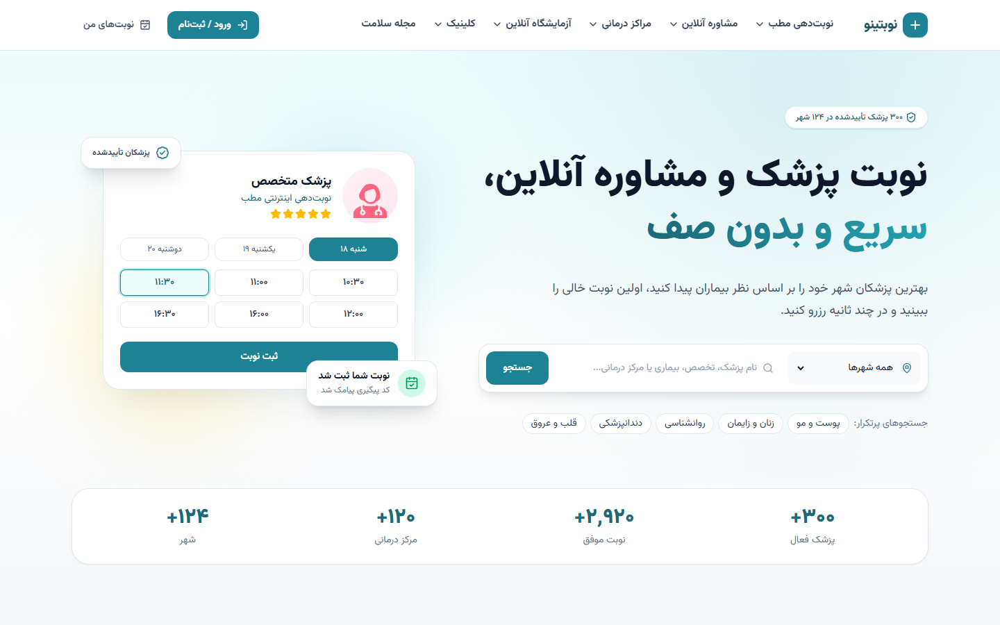
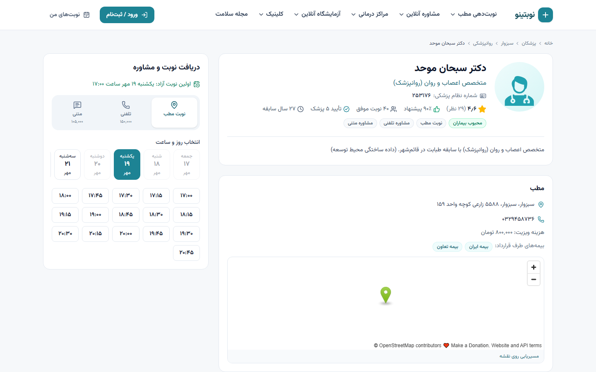
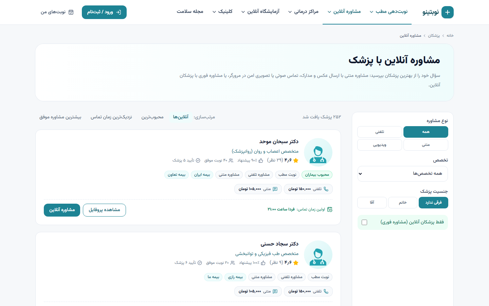
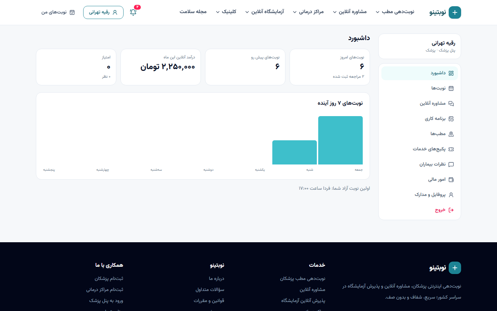
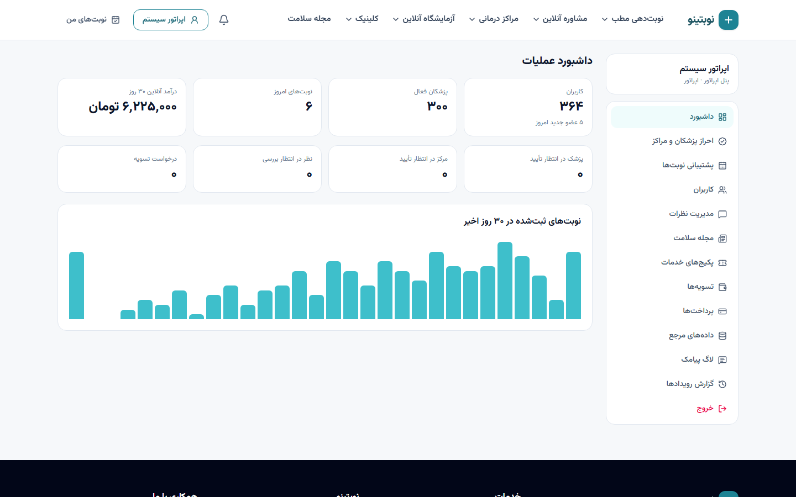
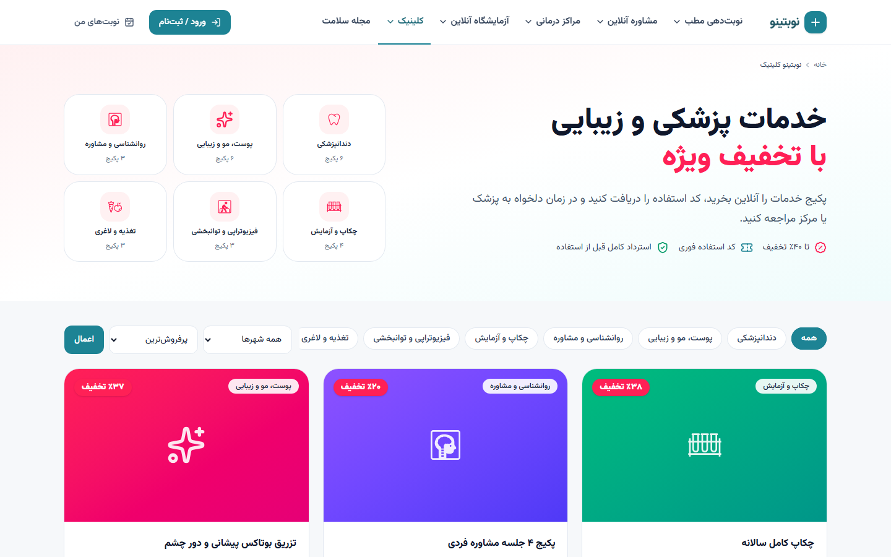
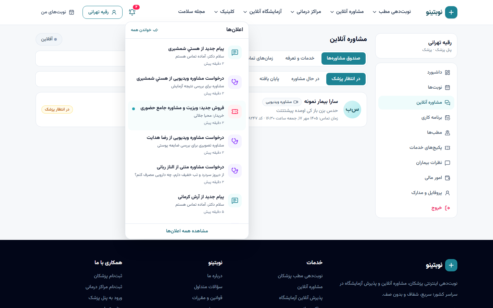

<div dir="rtl">

# نوبتینو — پلتفرم نوبت‌دهی پزشکی و مشاوره آنلاین

پلتفرم کامل **نوبت‌دهی اینترنتی پزشکان، مشاوره آنلاین (متنی، تلفنی، تصویری)، پذیرش آنلاین آزمایشگاه، مراکز درمانی، فروش پکیج خدمات و مجله سلامت** — با پنل بیمار، پزشک، مرکز درمانی و اپراتور.

> A full-stack Persian (RTL) medical booking & telehealth platform — Django REST + Next.js, PostgreSQL, Redis/Celery, WebRTC video calls, Docker deployment. Patient, doctor, clinic/lab and operator panels.



## امکانات

| | |
|---|---|
| 🔎 **جستجو و نوبت‌دهی مطب** | جستجو بر اساس شهر، تخصص، بیماری و نام؛ فیلتر بیمه، جنسیت، نوبت باز؛ رزرو آنی بدون تداخل |
| 💬 **مشاوره آنلاین** | متنی با عکس و PDF، تماس صوتی و تصویری داخل مرورگر (WebRTC)، مشاوره فوری با پزشکان آنلاین |
| 🧪 **آزمایشگاه آنلاین** | انتخاب آزمایش یا بارگذاری نسخه، نمونه‌گیری در منزل، دریافت جواب در پنل |
| 🏥 **مراکز درمانی** | بیمارستان، کلینیک، درمانگاه، تصویربرداری، داروخانه |
| 🎟️ **کلینیک** | خرید آنلاین پکیج خدمات با تخفیف و کد استفاده |
| 📰 **مجله سلامت** | مقالات با بازبینی علمی پزشک و پیشنهاد پزشکان مرتبط |
| 🔔 **اعلان‌ها** | زنگوله اعلان، اعلان دسکتاپ، پنجره تماس ورودی، پیامک |
| 💳 **پرداخت** | کیف پول، زرین‌پال، استرداد خودکار، تسویه پزشکان |
| 👨‍⚕️ **پنل‌ها** | بیمار، پزشک، مرکز درمانی، اپراتور + پنل ادمین جنگو |
| 🔐 **ورود** | فقط با موبایل و کد یکبار مصرف |

| | |
|---|---|
|  |  |
|  |  |
|  |  |

## فناوری‌ها

**بک‌اند**: Python 3.12 · Django 5.1 · Django REST Framework · PostgreSQL 16 · Redis 7 · Celery 5 · SimpleJWT
**فرانت**: Next.js 15 · React 19 · TypeScript · Tailwind CSS 4 · TanStack Query · WebRTC
**زیرساخت**: Docker Compose · nginx · Let's Encrypt · MinIO · coturn · GitHub Actions

## اجرای سریع

```bash
# بک‌اند
cd backend
python -m venv .venv
.venv/Scripts/python -m pip install -r requirements-dev.txt      # لینوکس/مک: .venv/bin/python
.venv/Scripts/python manage.py migrate
.venv/Scripts/python manage.py seed_reference
.venv/Scripts/python manage.py seed_fake
.venv/Scripts/python manage.py runserver 8000

# فرانت (ترمینال دیگر)
cd frontend
cp .env.example .env.local
npm install
npm run dev
```

سایت: http://localhost:3000 · مستندات API: http://localhost:8000/api/docs/

در صفحه ورود روی یکی از **حساب‌های نمایشی** بزنید؛ در محیط توسعه کد ورود روی صفحه نمایش داده می‌شود.

| نقش | موبایل |
|---|---|
| بیمار | `09120000003` |
| پزشک | `09120000001` |
| آزمایشگاه | `09120000002` |
| اپراتور | `09120000000` |

اجرا با Docker، رفع اشکال و سناریوهای امتحان: [docs/03-local-setup.md](docs/03-local-setup.md)

## مستندات

| | |
|---|---|
| [معرفی محصول](docs/01-overview.md) | [قوانین کسب‌وکار](docs/07-business-rules.md) |
| [معماری](docs/02-architecture.md) | [فرانت‌اند](docs/08-frontend.md) |
| [راه‌اندازی محلی](docs/03-local-setup.md) | [راهنمای پنل‌ها](docs/09-panels-guide.md) |
| [پیکربندی](docs/04-configuration.md) | [مشاوره آنلاین و تماس](docs/10-telehealth-and-calls.md) |
| [مدل داده](docs/05-data-model.md) | [اعلان‌ها](docs/11-notifications.md) |
| [مرجع API](docs/06-api-reference.md) | [امنیت](docs/12-security.md) |
| [تست](docs/13-testing.md) | [استقرار](docs/14-deployment-operations.md) |
| [آنلاین کردن سایت (DEPLOY)](DEPLOY.md) | [نقشه راه](docs/15-roadmap.md) |

## ساختار مخزن

```
backend/    Django REST API، منطق کسب‌وکار، Celery، تست‌ها، داده مرجع
frontend/   Next.js، صفحات عمومی و پنل‌ها، تست‌های E2E
infra/      Docker Compose توسعه و production، nginx، اسکریپت‌های سرور
docs/       مستندات
```

## تست

```bash
cd backend && .venv/Scripts/python -m pytest      # ۴۰ تست (SQLite و PostgreSQL)
cd frontend && npx playwright test                 # ۱۱ سناریوی E2E، شامل تماس تصویری واقعی
```

## داده‌ها و مجوزها

- داده‌های مرجع (۳۱ استان، ۲۴۸ شهر، ۱۰۴ تخصص و فوق‌تخصص، ۲۸ بیمه، ۴۷ بیماری، ۴۵ آزمایش) عمومی هستند.
- پزشکان، مراکز و بیماران نمایشی **ساختگی‌اند**؛ هیچ اطلاعات شخصی واقعی در مخزن نیست.
- عکس شهرها از Wikimedia Commons با مجوزهای آزاد ([منابع](frontend/src/data/city-credits.json))، آیکون‌های پزشکی از [Health Icons](https://healthicons.org) (CC0)، فونت [وزیرمتن](https://github.com/rastikerdar/vazirmatn) (OFL).

</div>
