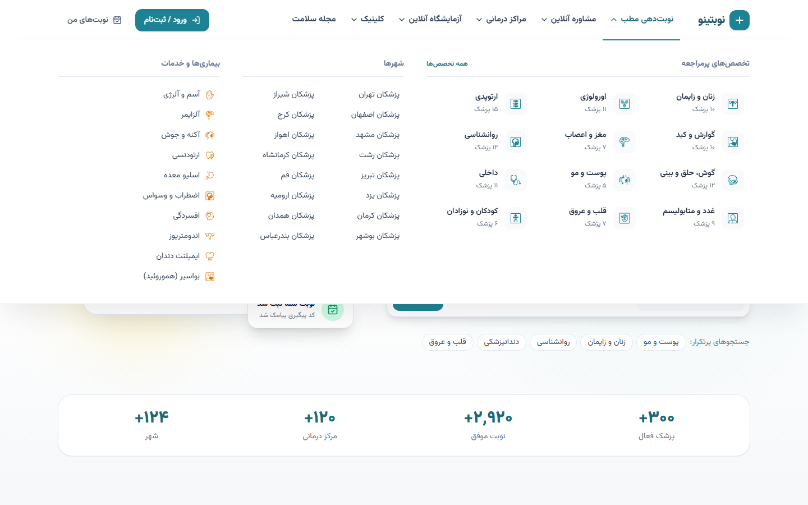
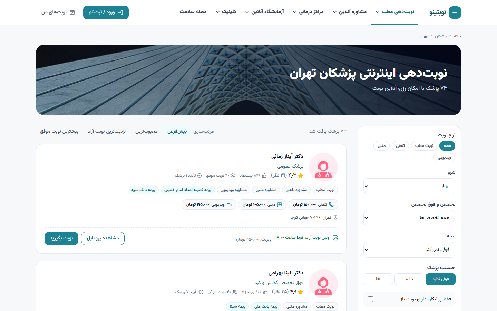
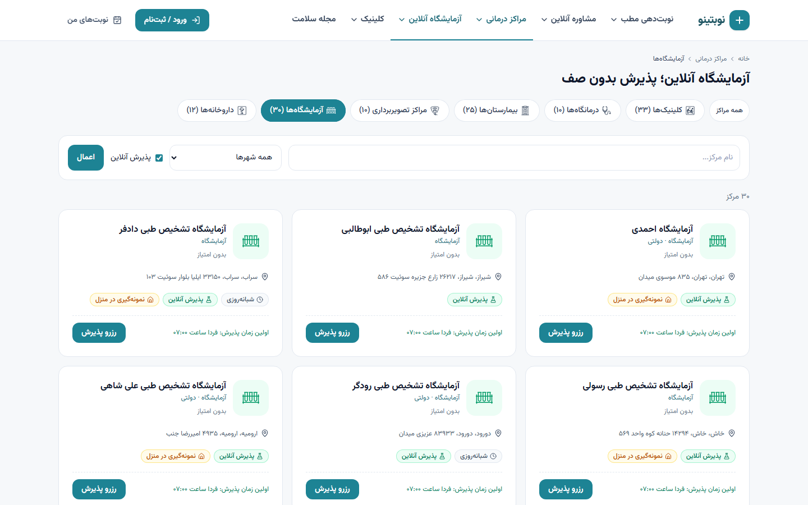
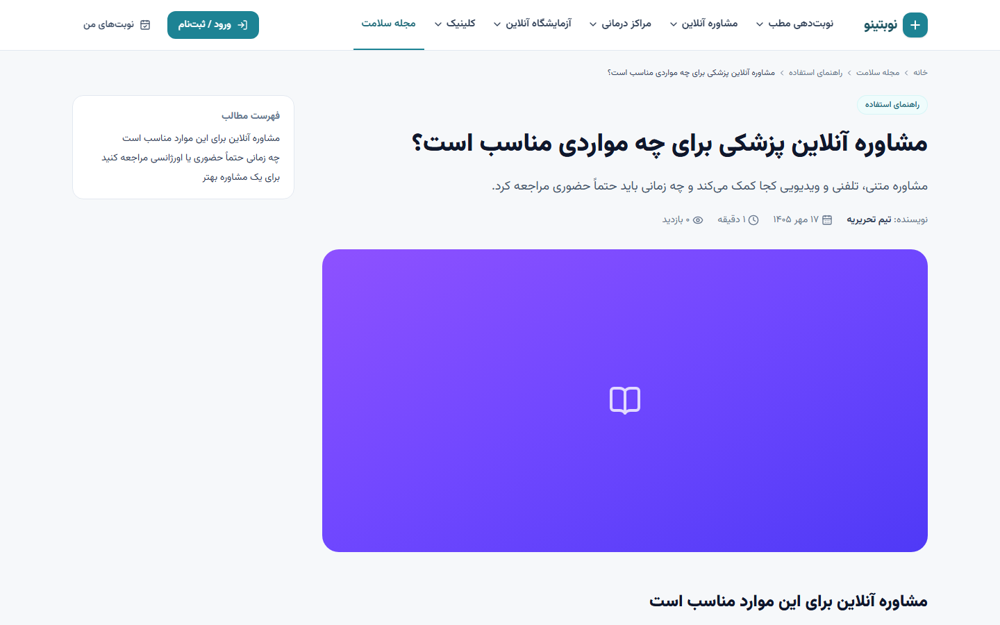
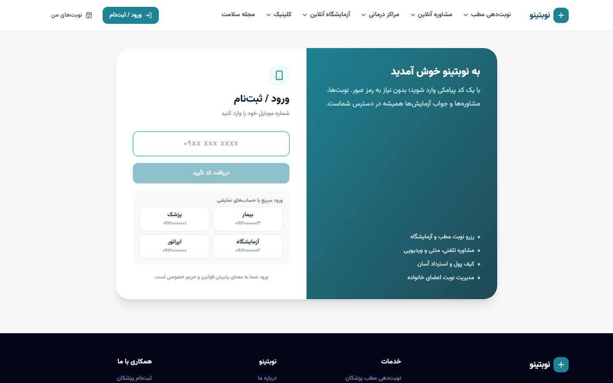

# ۱. معرفی محصول

پلتفرمی برای **نوبت‌دهی اینترنتی پزشکان، مشاوره آنلاین، پذیرش آزمایشگاه و مراکز درمانی، فروش پکیج خدمات و مجله سلامت** — هم‌سطح سرویس‌های شناخته‌شده این حوزه در ایران، با برند، طراحی و کد کاملاً مستقل.

## نقش‌ها

| نقش | کد در سیستم | کار اصلی | پنل |
|---|---|---|---|
| بیمار | `patient` | جستجو، رزرو نوبت، مشاوره آنلاین، پذیرش آزمایشگاه، خرید پکیج، کیف پول | `/panel` |
| پزشک | `doctor` | پروفایل، مطب‌ها، برنامه کاری، نوبت‌ها، مشاوره آنلاین، پکیج، مالی | `/doctor-panel` |
| کارمند مرکز درمانی | `center_staff` | اطلاعات مرکز، تعرفه آزمایش‌ها، پذیرش‌ها، جواب آزمایش، پکیج، مالی | `/center-panel` |
| اپراتور | `operator` | احراز پزشک/مرکز، پشتیبانی نوبت‌ها، نظرات، تسویه، مجله، پکیج‌ها، داده مرجع | `/ops` |
| مدیر کل | `superadmin` | همه دسترسی‌های اپراتور + پنل ادمین جنگو (`/admin`) | `/ops`، `/admin` |

هر کاربر با **شماره موبایل و کد یکبار مصرف** وارد می‌شود؛ رمز عبور ندارد. نقش «پزشک» یا «مرکز» با ثبت‌نام از صفحات `/join/doctor` و `/join/center` ایجاد می‌شود و پس از **تأیید اپراتور** در سایت نمایش داده می‌شود.

## امکانات عمومی (بدون ورود)

- **جستجوی هوشمند** در هدر و صفحه اصلی: نام پزشک، تخصص، بیماری یا مرکز، با فیلتر شهر و پیشنهاد لحظه‌ای. حروف عربی/فارسی (ي/ی، ك/ک) و ارقام فارسی یکسان‌سازی می‌شوند.
- **لیست پزشکان** با فیلتر نوع نوبت (مطب/تلفنی/متنی/ویدیویی)، شهر، تخصص و فوق‌تخصص، بیمه، جنسیت، «فقط دارای نوبت باز» و «مشاوره فوری»؛ مرتب‌سازی پیش‌فرض، محبوب‌ترین، نزدیک‌ترین نوبت و بیشترین نوبت موفق.
- **صفحات سئو**: `/doctors/city/{شهر}`، `/doctors/expertise/{تخصص}`، ترکیب هر دو، و «بهترین پزشک برای {بیماری}» در `/best-doctor/{بیماری}`.
- **پروفایل پزشک** `/doctor/{slug}/{short_id}`: مدرک، شماره نظام پزشکی، امتیاز، درصد پیشنهاد، نوبت‌های موفق، تأیید همکاران، مطب‌ها با نقشه و بیمه‌ها، نظرات بیماران، و ویجت رزرو با تب‌های «نوبت مطب / تلفنی / متنی / ویدیویی».
- **مراکز درمانی**: بیمارستان، کلینیک، درمانگاه، آزمایشگاه، تصویربرداری، داروخانه؛ صفحه هر مرکز با بیمه‌ها، بخش‌ها، پزشکان، تعرفه آزمایش‌ها و **پذیرش آنلاین آزمایشگاه** (انتخاب آزمایش یا بارگذاری نسخه، نمونه‌گیری در منزل).
- **مشاوره آنلاین** `/doctors/telehealth`: پزشکان آنلاین، قیمت هر نوع مشاوره، اولین زمان تماس.
- **کلینیک** `/offer`: پکیج خدمات تخفیف‌دار (دندانپزشکی، زیبایی، روانشناسی، چکاپ، فیزیوتراپی، تغذیه).
- **مجله سلامت** `/mag`: مقالات با بازبینی علمی پزشک و پیشنهاد پزشکان مرتبط.
- صفحات ثابت (درباره ما، قوانین، حریم خصوصی، تماس)، سؤالات متداول، منابع تصاویر.

| | |
|---|---|
|  |  |
|  |  |
|  |  |
|  |  |

## امکانات بیمار

- رزرو نوبت مطب برای خود یا **اعضای خانواده**، با پیش‌پرداخت (کیف پول یا درگاه) یا رایگان.
- رزرو پذیرش آزمایشگاه، مشاهده و دانلود **جواب آزمایش**.
- **مشاوره آنلاین**: متنی (با عکس/PDF)، تلفنی و ویدیویی داخل مرورگر، فوری با پزشکان آنلاین.
- **کیف پول**: شارژ، پرداخت، استرداد خودکار.
- **خرید پکیج خدمات** و دریافت کد استفاده.
- ثبت **نظر** بعد از مراجعه.
- **اعلان‌ها**: زنگوله اعلان، اعلان دسکتاپ، پنجره تماس ورودی.

## امکانات پزشک

- ثبت‌نام، بارگذاری مدارک (کارت نظام پزشکی و ...) و ارسال برای تأیید.
- چند مطب (یا حضور در یک مرکز) با بیمه‌ها، هزینه ویزیت و پیش‌پرداخت.
- **برنامه کاری هفتگی** و **مرخصی**؛ نوبت‌ها خودکار ساخته می‌شوند.
- لیست روزانه نوبت‌ها، ثبت «مراجعه کرد / نکرد»، لغو با استرداد کامل.
- **مشاوره آنلاین**: تعیین تعرفه هر نوع، زمان‌های تماس، کلید «آنلاین برای مشاوره فوری»، صندوق مشاوره‌ها.
- پکیج خدمات، ثبت استفاده با کد.
- پاسخ به نظرات، داشبورد آمار، **امور مالی** و درخواست تسویه.

## امکانات مرکز درمانی

- ثبت‌نام مرکز و تأیید اپراتور؛ اطلاعات، ساعات کاری، بیمه‌ها.
- برنامه پذیرش، تعرفه آزمایش‌ها، فعال‌سازی پذیرش آنلاین و نمونه‌گیری در منزل.
- لیست پذیرش‌ها، ثبت پذیرش، **بارگذاری جواب آزمایش** (بیمار پیامک و اعلان می‌گیرد).
- پکیج خدمات، امور مالی.

## امکانات اپراتور

- داشبورد (کاربران، پزشکان، نوبت‌ها، درآمد ۳۰ روز، کارهای در انتظار).
- **احراز** پزشکان و مراکز (مشاهده مدارک، تأیید/رد با دلیل).
- پشتیبانی نوبت‌ها (جستجو با کد پیگیری/موبایل/کد ملی، لغو با استرداد کامل).
- مدیریت کاربران (نقش، مسدودسازی، شارژ کیف پول با دلیل).
- مدیریت نظرات، تسویه‌ها، پرداخت‌ها، پکیج‌ها، مجله، داده‌های مرجع (تخصص، بیماری، بیمه، شهر، آزمایش).
- لاگ پیامک‌ها و **گزارش رویدادها** (audit log) از همه کارهای حساس.

## داده‌های مرجع

داده‌های عمومی و واقعی در `backend/fixtures/` هستند و با `seed_reference` بارگذاری می‌شوند:

- ۳۱ استان و ۲۴۸ شهر (۲۴ شهر پرمراجعه با ترتیب نمایش)
- ۴۱ تخصص اصلی (۲۴ مورد پرمراجعه) + ۶۳ فوق‌تخصص/فلوشیپ (مجموعاً ۱۰۴) و ۹ مدرک
- ۲۸ بیمه پایه و تکمیلی
- ۴۷ بیماری/خدمت برای صفحات «بهترین پزشک برای ...»
- ۴۵ آزمایش رایج با ساعت ناشتایی

پزشکان و مراکز نمایشی با `seed_fake` و نام‌های ساختگی (Faker) ساخته می‌شوند و **هیچ اطلاعات شخصی واقعی** در پروژه نیست.

