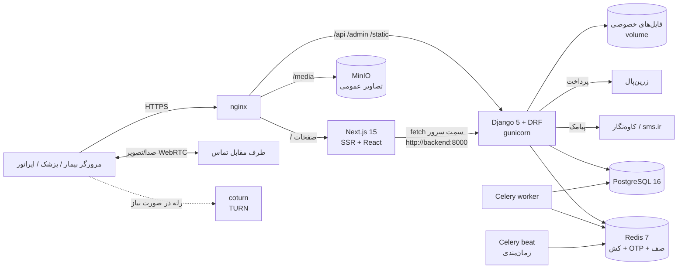
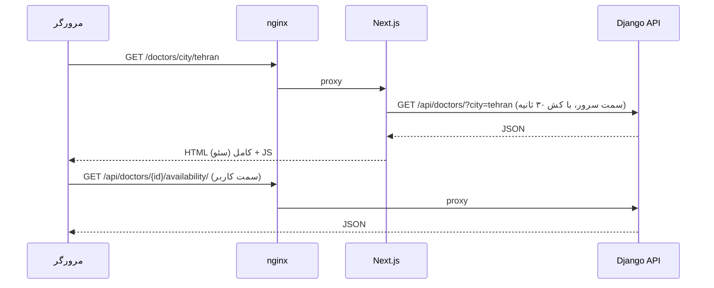
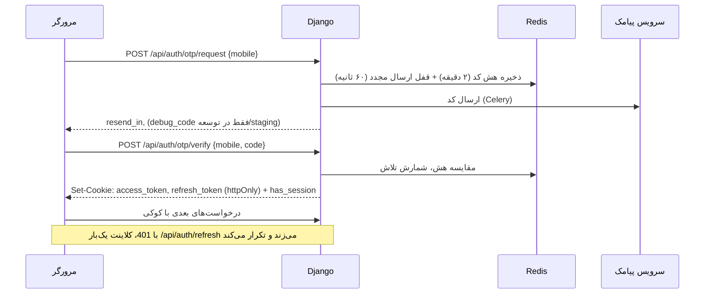

<div dir="rtl">

# ۲. معماری

## نمای کلی



| جزء | فناوری | نقش |
|---|---|---|
| فرانت‌اند | Next.js 15 (App Router)، React 19، TypeScript، Tailwind CSS 4، TanStack Query 5 | صفحات SSR برای سئو، پنل‌ها، اتاق مشاوره |
| بک‌اند | Django 5.1، Django REST Framework، SimpleJWT، django-filter، drf-spectacular | API، منطق کسب‌وکار، پنل ادمین |
| پایگاه داده | PostgreSQL 16 (در توسعه SQLite هم کار می‌کند) | داده اصلی |
| کش و صف | Redis 7 | کش، کد OTP، محدودیت نرخ، صف Celery |
| کارهای پس‌زمینه | Celery 5 (worker + beat) | پیامک، ساخت نوبت‌ها، انقضا، یادآوری، آمار |
| فایل | MinIO (سازگار با S3) برای تصاویر عمومی؛ volume خصوصی برای مدارک پزشکی | |
| تماس | WebRTC در مرورگر + coturn (TURN) | تماس صوتی/تصویری مشاوره |
| وب‌سرور | nginx + Let's Encrypt | SSL، مسیریابی، محدودیت نرخ، Basic Auth در staging |

## ساختار پوشه‌ها

```
doctor-platform/
├── backend/                  Django
│   ├── config/               تنظیمات (base/dev/test/prod)، urls، celery، wsgi
│   ├── apps/
│   │   ├── core/             ابزارها، صفحه‌بندی، دسترسی‌ها، جستجو، ذخیره خصوصی، دستورات seed
│   │   ├── accounts/         کاربر، OTP، JWT در کوکی، اعضای خانواده، make_admin
│   │   ├── geo/              استان و شهر
│   │   ├── catalog/          تخصص، مدرک، بیماری، بیمه
│   │   ├── doctors/          پروفایل پزشک، مطب، مدارک، تأیید همکار، API پنل پزشک
│   │   ├── centers/          مراکز درمانی، کارمندان، API پنل مرکز
│   │   ├── scheduling/       برنامه هفتگی، مرخصی، Slot، نوبت (Appointment)، رزرو
│   │   ├── lab/              کاتالوگ آزمایش، تعرفه مرکز، پذیرش آزمایشگاه
│   │   ├── consult/          مشاوره آنلاین، پیام، سیگنال تماس، تعرفه و زمان تماس
│   │   ├── payments/         کیف پول، پرداخت، درگاه، تسویه
│   │   ├── reviews/          نظرات و آمار امتیاز
│   │   ├── clinic/           پکیج خدمات و خرید آن
│   │   ├── magazine/         مجله سلامت
│   │   ├── notifications/    پیامک، اعلان درون‌برنامه، یادآوری
│   │   ├── cms/              صفحات ثابت، سؤالات متداول، بنر
│   │   └── ops/              API پنل اپراتور، audit log
│   ├── fixtures/             داده مرجع (JSON)
│   ├── tests/                تست‌های pytest
│   ├── Dockerfile, entrypoint.sh, requirements*.txt
├── frontend/                 Next.js
│   ├── src/app/              مسیرها (صفحات عمومی، پنل‌ها، اتاق مشاوره ...)
│   ├── src/components/       کامپوننت‌ها (layout، booking، consult، panel، notifications، ...)
│   ├── src/lib/              API کلاینت، انواع داده، قالب‌بندی، آیکون‌ها، ...
│   ├── src/data/             منابع تصاویر شهرها
│   ├── public/images/cities/ عکس شهرها (مجوز آزاد)
│   ├── e2e/                  تست‌های Playwright
│   └── scripts/              ابزار گرفتن اسکرین‌شات مستندات
├── infra/                    docker-compose (dev/prod)، nginx، اسکریپت‌های سرور، بکاپ
├── docs/                     همین مستندات
├── .github/workflows/ci.yml  CI
├── README.md, DEPLOY.md
```

## جریان یک درخواست

### صفحه عمومی (مثلاً لیست پزشکان)



- صفحات عمومی **سمت سرور** رندر می‌شوند تا موتورهای جستجو محتوای کامل را ببینند (`generateMetadata`، JSON-LD، sitemap).
- بخش‌های پویا (زمان‌های خالی، رزرو، پنل‌ها، اتاق مشاوره) **سمت کاربر** با TanStack Query بارگذاری می‌شوند.
- در production، nginx مسیر `/api` را مستقیم به Django می‌فرستد. در توسعه، Next.js با `rewrites` همین مسیر را به `API_INTERNAL_URL` پروکسی می‌کند، پس مرورگر همیشه با **یک دامنه** کار می‌کند و کوکی‌ها مشترک‌اند.

### ورود و احراز هویت



جزئیات بیشتر: [امنیت](12-security.md).

### کارهای پس‌زمینه (Celery beat)

| کار | هر چند وقت | کار انجام‌شده |
|---|---|---|
| `generate_slots_task` | ۱ ساعت | ساخت Slotها از برنامه هفتگی برای ۳۰ روز آینده (مطب‌ها، مراکز، زمان‌های تماس آنلاین) |
| `release_expired_holds` | ۱ دقیقه | نوبت‌های پرداخت‌نشده بعد از ۱۰ دقیقه منقضی و آزاد می‌شوند |
| `send_reminders` | ۱۵ دقیقه | یادآوری ۲۴ و ۲ ساعته (پیامک + اعلان) |
| `refresh_all_stats` | ۳۰ دقیقه | محاسبه امتیاز، درصد پیشنهاد، میانگین معطلی و محبوبیت |
| `expire_consultations` | ۱ دقیقه | استرداد مشاوره‌های بی‌پاسخ، بستن گفتگوهای متنی منقضی |
| `expire_package_orders` | ۵ دقیقه | انقضای سفارش‌های پرداخت‌نشده و کدهای منقضی |

در توسعه بدون Redis، Celery به‌صورت **eager** (همزمان، داخل همان درخواست) اجرا می‌شود؛ کارهای زمان‌بندی‌شده اجرا نمی‌شوند مگر با Docker.

## اصول طراحی کد

- **منطق کسب‌وکار در `services.py`** هر اپ است (مثلاً `scheduling/services.py`، `consult/services.py`، `clinic/services.py`)؛ viewها نازک هستند.
- **همه تغییرات وضعیت نوبت** از `scheduling/services.py` می‌گذرند: `book_slot`، `create_appointment`، `confirm_payment`، `cancel_appointment`، `expire_holds`، `mark_attendance`.
- **مشاوره آنلاین و پذیرش آزمایشگاه هر دو یک `Appointment` هستند** (با `kind` متفاوت) تا پرداخت، استرداد، نظر، پنل‌ها و پشتیبانی برای همه یکسان باشد. جزئیات اختصاصی در `Consultation` و `LabReception` (رابطه یک‌به‌یک).
- **قفل و همزمانی**: رزرو با UPDATE شرطی اتمیک (`booked_count < capacity`) و تغییرات حساس با `select_for_update(of=("self",))`؛ روی هر دو SQLite و PostgreSQL امن است.
- **داده‌های کش‌شده** روی پزشک (امتیاز، اولین نوبت آزاد و ...) برای سرعت لیست‌ها نگه داشته و دوره‌ای به‌روز می‌شوند؛ مقدارهای گذشته (مثلاً اولین نوبتی که زمانش گذشته) نادیده گرفته می‌شوند.

</div>
