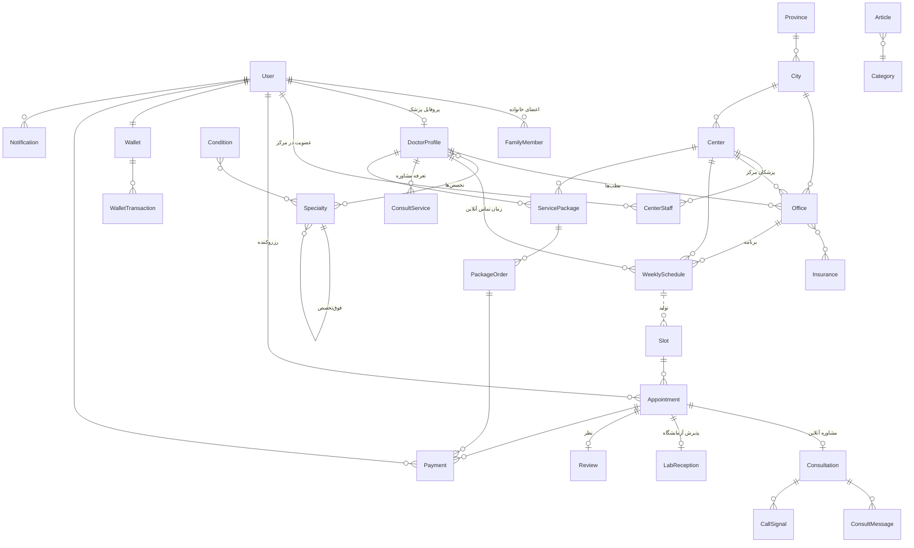
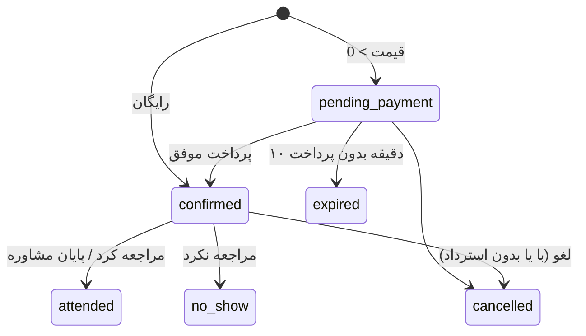

<div dir="rtl">

# ۵. مدل داده

همه مدل‌ها در `backend/apps/<app>/models.py` هستند. مبالغ همه به **تومان** و عدد صحیح‌اند. زمان‌ها با منطقه زمانی `Asia/Tehran` نمایش و به‌صورت UTC ذخیره می‌شوند.

## نمودار روابط اصلی



## accounts

### `User` — کاربر
| فیلد | نوع | توضیح |
|---|---|---|
| `mobile` | char(11)، یکتا | شناسه ورود، همیشه به شکل `09xxxxxxxxx` |
| `first_name`، `last_name` | char | |
| `national_code` | char(10) | با چک‌دیجیت اعتبارسنجی می‌شود |
| `gender` | `male` / `female` | |
| `birth_date`، `email` | | اختیاری |
| `insurance` | FK → Insurance | بیمه پایه |
| `role` | `patient`، `doctor`، `center_staff`، `operator`، `superadmin` | |
| `is_active` | bool | کاربر مسدود نمی‌تواند وارد شود |
| `is_staff`، `is_superuser` | bool | دسترسی ادمین جنگو |

`profile_completed` = نام، نام خانوادگی و کد ملی پر باشد (شرط رزرو برای خود).

### `FamilyMember`
`owner` (FK User)، نام، نام خانوادگی، `national_code` (یکتا برای هر owner)، جنسیت، تاریخ تولد، `relation` (`child`، `spouse`، `parent`، `sibling`، `other`).

## geo و catalog

| مدل | فیلدهای مهم |
|---|---|
| `Province` | `name`، `slug` |
| `City` | `province`، `name`، `slug` (انگلیسی، مثل `tehran`)، `lat`، `lng`، `is_popular`، `order` |
| `Specialty` | `parent` (برای فوق‌تخصص)، `name`، `title` (عنوان پزشک، مثلاً «متخصص قلب و عروق»)، `slug`، `icon`، `is_popular`، `order`، `description` |
| `Degree` | `name`، `slug` (`specialist`، `subspecialist`، `fellowship`، `gp`، `dentist`، `phd`، `msc`، `bsc`، `pharmacist`) |
| `Condition` | `name`، `slug`، `specialties` (M2M)، `synonyms`، `is_popular` |
| `Insurance` | `name`، `slug`، `kind` (`basic` / `supplementary`)، `logo`، `order` |

## doctors

### `DoctorProfile`
| فیلد | توضیح |
|---|---|
| `user` | یک‌به‌یک با User |
| `first_name`، `last_name`، `gender` | |
| `short_id` | شناسه ۶ کاراکتری یکتا در URL (مثل `qjYayZ`) |
| `slug` | فارسی، از نام (فقط برای زیبایی URL؛ جستجو با `short_id`) |
| `medical_council_no` | یکتا |
| `degree`، `specialties` (M2M)، `primary_specialty` | |
| `bio`، `photo`، `experience_start_year` (شمسی) | |
| `offers_phone`، `offers_text`، `offers_video`، `offers_instant` | همگام با `ConsultService` (برای فیلتر سریع) |
| `is_online_now`، `online_seen_at` | آنلاین برای مشاوره فوری (+ ضربان حضور) |
| `verification_status` | `draft` → `pending` → `approved` / `rejected`؛ `rejection_reason` |
| `is_active` | نمایش در سایت |
| **کش** `rating_avg`، `review_count`، `recommend_pct`، `avg_wait_minutes`، `successful_appointments`، `endorsement_count`، `popularity`، `first_free_slot_at`، `first_online_slot_at` | برای سرعت لیست‌ها |
| `search_text` | متن یکسان‌سازی‌شده برای جستجو |

`is_public` = تأییدشده و فعال. `available_now` = `offers_instant` و `is_online_now` و حضور در ۵ دقیقه اخیر.

### `Office` — مطب یا حضور در مرکز
`doctor`، `center` (اختیاری)، `title`، `city`، `address`، `lat`/`lng`، `phone`، `insurances` (M2M)، `visit_fee` (اطلاع‌رسانی)، `booking_fee` (پیش‌پرداخت آنلاین)، `booking_enabled`، `notes`، `is_active`.

### `DoctorDocument`
`doctor`، `kind` (`council_card`، `national_card`، `degree`، `office_license`، `other`)، `file` (**ذخیره خصوصی**).

### `Endorsement`
`from_doctor` → `to_doctor` (یکتا) — «تأیید همکار».

## centers

### `Center`
`type` (`hospital`، `clinic`، `darmangah`، `laboratory`، `imaging`، `pharmacy`)، `name`، `slug`، `city`، `address`، `lat`/`lng`، `phone`، `website`، `description`، `logo`، `cover`، `insurances`، `specialties`، `working_hours`، `is_24h`، `is_public_sector`، `has_home_sampling`، `online_reception`، `reception_fee`، `home_sampling_fee`، `verification_status`، `is_active`، کش امتیاز و `first_free_slot_at`.

### `CenterStaff`
`center`، `user`، `role` (`manager` / `reception`).

## scheduling

### `WeeklySchedule`، `ScheduleException`، `Slot`
هر سه **دقیقاً یک مالک** دارند (قید پایگاه داده): `office` (نوبت مطب)، `center` (پذیرش مرکز) یا `doctor` (زمان تماس آنلاین).

| مدل | فیلدها |
|---|---|
| `WeeklySchedule` | `weekday` (۰=شنبه ... ۶=جمعه)، `start_time`، `end_time`، `slot_minutes`، `capacity`، `kind`، `is_active` |
| `ScheduleException` | `date`، `start_time`/`end_time` (خالی = کل روز)، `reason` |
| `Slot` | `start`، `end`، `capacity`، `booked_count`، `kind` (`in_person`، `lab`، `online`)، `is_blocked`؛ یکتا روی (مالک، `start`، `kind`) |

### `Appointment` — نوبت (مطب، آزمایشگاه یا مشاوره آنلاین)
| فیلد | توضیح |
|---|---|
| `tracking_code` | کد پیگیری ۸ رقمی یکتا |
| `kind` | `in_person`، `lab`، `phone`، `text`، `video` |
| `status` | `pending_payment`، `confirmed`، `attended`، `no_show`، `cancelled`، `expired` |
| `slot` | برای مشاوره متنی و فوری خالی است |
| `doctor`، `office`، `center`، `user`، `family_member` | |
| `patient_name`، `patient_national_code`، `patient_mobile` | تصویر لحظه رزرو |
| `start` | زمان نوبت (برای متنی/فوری = زمان ثبت) |
| `price`، `paid_amount`، `refunded_amount` | |
| `held_until` | مهلت پرداخت (۱۰ دقیقه) |
| `patient_note`، `cancelled_at`، `cancelled_by`، `cancel_reason` | |
| `reminded_24h`، `reminded_2h` | |



## lab
| مدل | فیلدها |
|---|---|
| `LabTest` | `name`، `en_name`، `slug`، `category`، `preparation`، `fasting_hours`، `result_days` |
| `CenterLabTest` | `center`، `test`، `price`، `is_active` |
| `LabReception` | `appointment` (۱:۱)، `tests` (M2M)، `prescription` (خصوصی)، `has_insurance_prescription`، `home_sampling`، `home_address`، `estimated_price`، `status` (`booked`، `sampled`، `result_ready`)، `result_file` (خصوصی) |

## consult — مشاوره آنلاین
| مدل | فیلدها |
|---|---|
| `ConsultService` | `doctor`، `kind` (`phone`/`text`/`video`)، `price`، `duration_minutes`، `instant_enabled`، `is_active`؛ یکتا روی (doctor، kind) |
| `Consultation` | `appointment` (۱:۱)، `kind`، `is_instant`، `complaint`، `state` (`waiting`، `active`، `closed`)، `doctor_deadline`، `started_at`، `closes_at`، `closed_at`، `doctor_summary` |
| `ConsultMessage` | `consultation`، `sender`، `from_doctor`، `is_system`، `text`، `file` (خصوصی)، `created_at` |
| `CallSignal` | `consultation`، `sender`، `kind` (`ring`، `offer`، `answer`، `candidate`، `hangup`، `decline`)، `payload` (JSON)، `created_at` — بعد از ۲ ساعت پاک می‌شود |

## payments
| مدل | فیلدها |
|---|---|
| `Wallet` | `user` (۱:۱)، `balance` |
| `WalletTransaction` | `wallet`، `amount` (+/-)، `balance_after`، `kind` (`topup`، `payment`، `refund`، `adjust`)، `appointment`، `description` |
| `Payment` | `user`، `purpose` (`appointment`، `wallet_topup`، `package`)، `appointment` / `package_order`، `amount` (مبلغ درگاه)، `wallet_amount`، `gateway`، `authority`، `ref_id`، `card_pan`، `status` (`init`، `redirected`، `paid`، `failed`)، `paid_at`، `error` |
| `Settlement` | `doctor` یا `center`، `amount`، `iban`، `status` (`requested`، `paid`، `rejected`)، `bank_ref`، `note`، `processed_by`، `processed_at` |

## reviews
`Review`: `appointment` (۱:۱)، `user`، `doctor` یا `center`، `rating` (۱ تا ۵)، `recommends`، `wait_minutes` (۱۰/۲۵/۴۵/۷۵)، `text`، `show_name`، `status` (`pending`، `approved`، `rejected`)، `reply`، `replied_at`.

## clinic — پکیج خدمات
| مدل | فیلدها |
|---|---|
| `ServicePackage` | `title`، `slug`، `category` (`dentistry`، `beauty`، `psychology`، `checkup`، `physio`، `nutrition`، `other`)، `doctor` یا `center` (دقیقاً یکی)، `city`، `address`، `cover`، `summary`، `description`، `includes` (هر خط یک مورد)، `terms`، `original_price`، `price` (≤ قیمت اصلی)، `valid_days`، `capacity`، `max_per_user`، `sold_count`، `status` (`pending`، `approved`، `rejected`)، `is_active` |
| `PackageOrder` | `package`، `user`، `status` (`pending_payment`، `paid`، `used`، `cancelled`، `expired`)، `voucher_code` (۸ کاراکتر)، `price`، `paid_amount`، `refunded_amount`، `held_until`، `paid_at`، `expires_at`، `used_at`، `redeemed_by`، `buyer_name`، `buyer_mobile` |

## magazine
| مدل | فیلدها |
|---|---|
| `Category` | `name`، `slug`، `description`، `order` |
| `Article` | `title`، `slug`، `category`، `excerpt`، `body` (Markdown)، `cover`، `author`، `author_name`، `reviewed_by` (پزشک)، `specialties`، `conditions`، `status` (`draft`/`published`)، `published_at`، `is_featured`، `views`، `seo_title`، `seo_description` |

## notifications، cms، ops
| مدل | فیلدها |
|---|---|
| `Notification` | `user`، `kind` (۱۵ نوع، [اعلان‌ها](11-notifications.md))، `title`، `body`، `link`، `count` (پیام‌های ادغام‌شده)، `is_read`، `read_at`، `created_at` |
| `SmsLog` | `mobile`، `kind`، `text` (برای OTP واقعی متن کد ذخیره نمی‌شود)، `status`، `provider_ref`، `error` |
| `Page` | `slug`، `title`، `body` (Markdown)، `is_published` |
| `Faq` | `category`، `question`، `answer`، `order` |
| `Banner` | `title`، `subtitle`، `image`، `link`، `is_active`، `order` |
| `AuditLog` | `actor`، `action`، `target_type`، `target_id`، `target_repr`، `data` (JSON)، `ip`، `created_at` |

## مهاجرت‌ها و داده اولیه

```bash
python manage.py makemigrations   # بعد از تغییر مدل
python manage.py migrate
python manage.py seed_reference   # داده مرجع؛ تکرارپذیر (upsert بر اساس slug)
python manage.py seed_magazine    # دسته‌ها و مقالات راهنمای اولیه (فقط موارد جدید)
python manage.py seed_fake        # داده نمایشی؛ فقط با DEBUG یا STAGING
python manage.py make_admin 09121234567 --role superadmin
```

</div>
