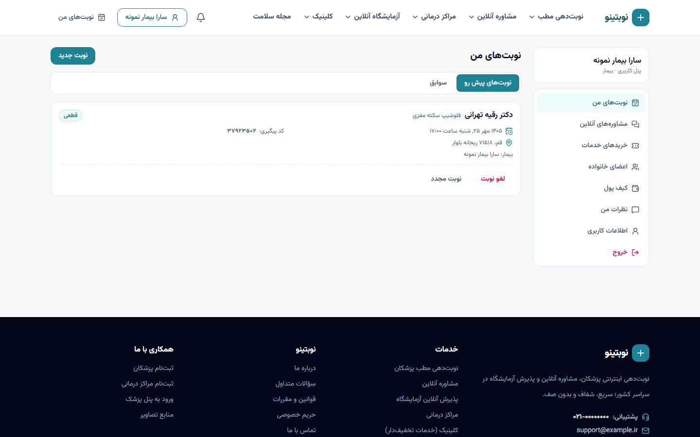
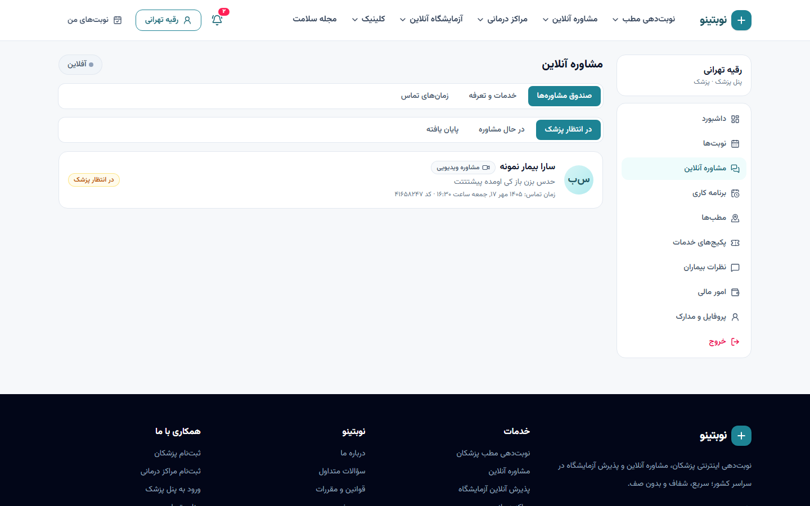

# ۹. راهنمای کار با پنل‌ها

## بیمار — `/panel`

| بخش | کار |
|---|---|
| نوبت‌های من | نوبت‌های پیش رو و سوابق؛ لغو، نوبت مجدد، تکمیل پرداخت، ثبت نظر بعد از مراجعه، دانلود جواب آزمایش، ورود به اتاق مشاوره |
| مشاوره‌های آنلاین | در انتظار پزشک / در حال مشاوره / پایان یافته |
| خریدهای خدمات | کدهای استفاده پکیج‌ها، پرداخت، لغو و استرداد |
| اعضای خانواده | افزودن فرزند، همسر و ... برای رزرو به نام آن‌ها |
| کیف پول | موجودی، شارژ، تراکنش‌ها |
| نظرات من | وضعیت انتشار و پاسخ پزشک |
| اطلاعات کاربری | نام، کد ملی، جنسیت، تاریخ تولد، بیمه |

**رزرو نوبت**: پروفایل پزشک ← (اگر چند مطب دارد، مطبی که زودتر نوبت دارد پیش‌فرض انتخاب است) ← روز ← ساعت ← «نوبت برای» (خودم یا عضو خانواده) ← ثبت ← پرداخت ← کد پیگیری.

**مشاوره آنلاین**: پروفایل پزشک ← تب تلفنی/متنی/ویدیویی ← (فوری یا انتخاب زمان) ← شرح حال ← پرداخت ← «ورود به اتاق مشاوره».

**اعلان‌ها**: زنگوله بالای سایت؛ با اجازه مرورگر، اعلان دسکتاپ هم می‌آید. اگر پزشک تماس بگیرد، در هر صفحه‌ای از سایت پنجره «تماس ورودی» با صدای زنگ باز می‌شود.

## پزشک — `/doctor-panel`

### شروع کار
1. **پروفایل و مدارک**: عکس، بیوگرافی، سال شروع طبابت؛ بارگذاری کارت نظام پزشکی (الزامی) و سایر مدارک؛ «ارسال برای تأیید».
2. **مطب‌ها**: آدرس، شهر، مختصات (برای نقشه)، تلفن، بیمه‌ها، هزینه ویزیت (اطلاع‌رسانی) و **پیش‌پرداخت آنلاین** (صفر = رزرو رایگان).
3. **برنامه کاری**: برای هر مطب روزها و ساعت‌ها، مدت هر نوبت و ظرفیت؛ مرخصی کل روز یا بازه‌ای.

### کار روزانه
- **داشبورد**: نوبت‌های امروز، پیش رو، درآمد ماه، امتیاز، نمودار ۷ روز.
- **نوبت‌ها**: انتخاب روز، جستجو با نام/کد ملی/کد پیگیری، «مراجعه کرد» / «مراجعه نکرد» / «لغو و استرداد».
- **مشاوره آنلاین**:
  - *صندوق مشاوره‌ها*: در انتظار / در حال مشاوره / پایان یافته.
  - *خدمات و تعرفه*: فعال‌سازی متنی/تلفنی/ویدیویی، قیمت، مدت تماس، امکان فوری.
  - *زمان‌های تماس*: برنامه هفتگی و مرخصی برای مشاوره تلفنی/ویدیویی.
  - کلید **آنلاین/آفلاین** برای مشاوره فوری (تا وقتی پنل باز است فعال می‌ماند).
- **اتاق مشاوره**: پاسخ متنی و فایل، «پذیرش و شروع مشاوره»، «شروع تماس»، «پایان مشاوره و ثبت توصیه».
- **پکیج‌های خدمات**: ثبت استفاده با کد، تعریف پکیج (پس از تأیید اپراتور نمایش داده می‌شود)، لیست فروش.
- **نظرات بیماران**: پاسخ عمومی به هر نظر.
- **امور مالی**: درآمد ناخالص، کارمزد، تسویه‌شده، قابل برداشت؛ درخواست تسویه با شبا.

## مرکز درمانی / آزمایشگاه — `/center-panel`

| بخش | کار |
|---|---|
| پذیرش‌ها | لیست روزانه، «پذیرش شد»، «مراجعه نکرد»، لغو، **بارگذاری جواب آزمایش** |
| برنامه پذیرش | ساعات و ظرفیت هر نوبت پذیرش، تعطیلی‌ها |
| آزمایش‌ها و تعرفه | قیمت هر آزمایش، فعال/غیرفعال، افزودن از کاتالوگ |
| پکیج‌های خدمات | مثل پزشک (مثلاً چکاپ کامل) |
| امور مالی | مثل پزشک |
| اطلاعات مرکز | نام، آدرس، تلفن، ساعات، پذیرش آنلاین، نمونه‌گیری در منزل و هزینه‌ها |

## اپراتور — `/ops`

| بخش | کار |
|---|---|
| داشبورد | کاربران، پزشکان فعال، نوبت‌های امروز، درآمد ۳۰ روز، کارهای در انتظار، نمودار |
| احراز پزشکان و مراکز | مشاهده مدارک، تأیید، رد با دلیل (پیامک و اعلان به کاربر) |
| پشتیبانی نوبت‌ها | جستجو با کد پیگیری/موبایل/کد ملی/نام؛ لغو با استرداد کامل |
| کاربران | جستجو، تغییر نقش، مسدودسازی، شارژ کیف پول با دلیل |
| مدیریت نظرات | انتشار یا رد |
| مجله سلامت | نوشتن مقاله با پیش‌نمایش، دسته، تصویر، بازبینی علمی پزشک، انتشار |
| پکیج‌های خدمات | تأیید/رد پکیج‌ها، جستجوی خرید و استرداد |
| تسویه‌ها | ثبت واریز با کد پیگیری بانک، یا رد |
| پرداخت‌ها | جستجو با کد رهگیری یا موبایل |
| داده‌های مرجع | تخصص، بیماری، بیمه، شهر، آزمایش |
| لاگ پیامک / گزارش رویدادها | همه پیامک‌ها (کد ورود مخفی) و همه کارهای حساس با کاربر، زمان و IP |

**ساخت اپراتور**: روی سرور `./scripts/manage.sh make_admin 09xxxxxxxxx --role operator` یا مدیر کل در «کاربران» نقش را تغییر می‌دهد (نقش مدیر کل را فقط مدیر کل می‌تواند بدهد).

