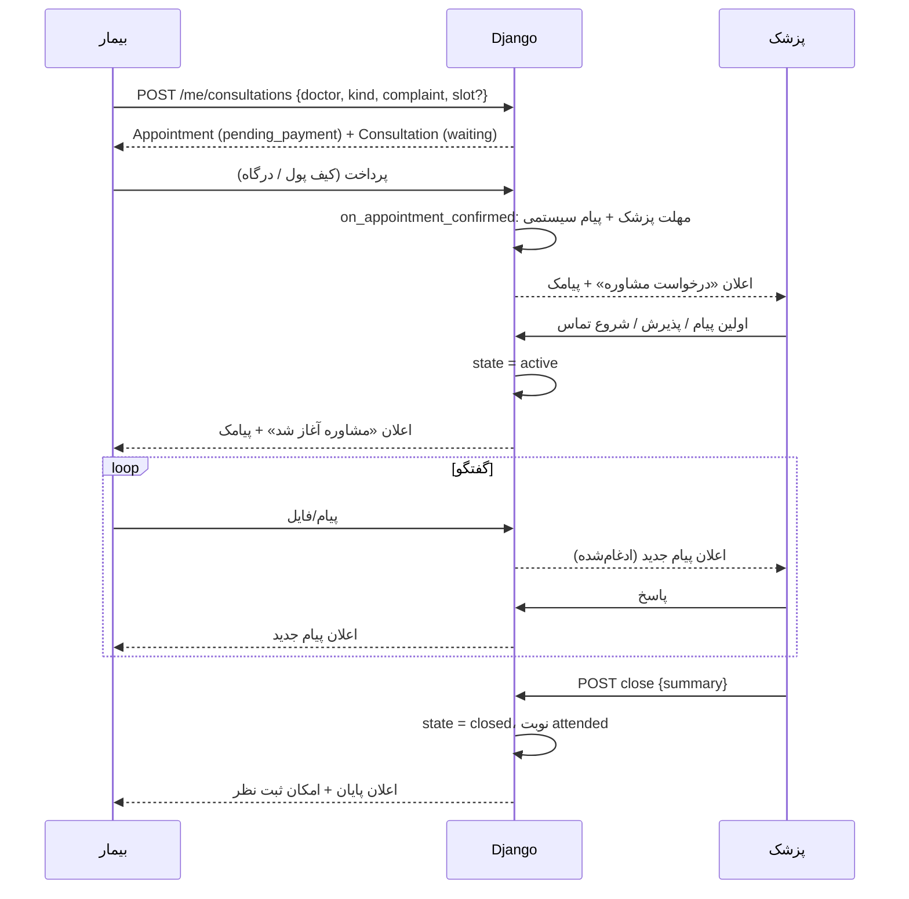
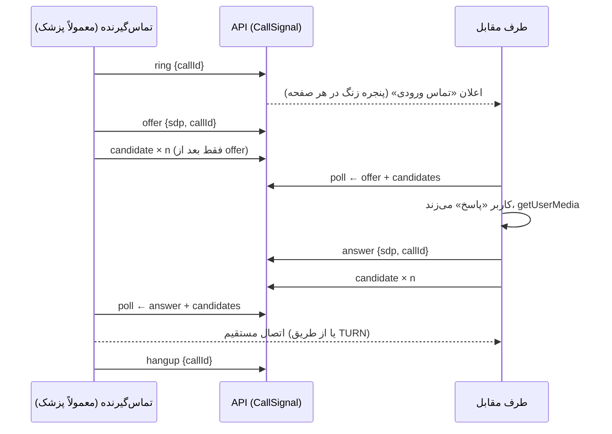

# ۱۰. مشاوره آنلاین و تماس تصویری

## چرخه مشاوره

- هر مشاوره یک `Appointment` (با `kind` = `phone` / `text` / `video`) + یک `Consultation` است؛ پس پرداخت، استرداد، نظر و پشتیبانی اپراتور مثل نوبت مطب کار می‌کند.
- **مهلت‌ها و استرداد خودکار**: [قوانین کسب‌وکار](07-business-rules.md#مشاوره-آنلاین-appsconsultservicespy). کار `expire_consultations` هر دقیقه اجرا می‌شود.
- **چت**: پیام‌ها با `GET .../messages/?after={آخرین id}` هر ۳ ثانیه دریافت می‌شوند (بدون نیاز به WebSocket).

## تماس صوتی/تصویری (WebRTC)

تماس **مستقیم بین دو مرورگر** است؛ صدا و تصویر از سرور عبور نمی‌کند (مگر از طریق TURN وقتی اتصال مستقیم ممکن نیست). شماره تلفن طرفین برای هم نمایش داده نمی‌شود.

### سیگنالینگ از طریق API
برای تبادل اطلاعات اتصال، به‌جای WebSocket از همان API و **polling** استفاده می‌شود (`/me/consultations/{code}/signals/`) تا پشت هر پروکسی و فایروالی کار کند.

نکات پیاده‌سازی (`frontend/src/components/consult/CallPanel.tsx`):
- هر تماس یک **`callId`** تصادفی دارد؛ candidateهای تماس‌های قبلی با تماس جدید قاطی نمی‌شوند.
- candidateهای محلی **تا ارسال offer/answer صف می‌شوند** تا طرف مقابل هرگز آن‌ها را قبل از offer دریافت نکند (این مشکل در عمل باعث وصل نشدن تصادفی تماس می‌شد و رفع شده است).
- candidateهای دریافتی قبل از offer/answer بافر و بعد اعمال می‌شوند.
- سیگنال‌های قدیمی‌تر از ۶۰ ثانیه هنگام ورود به صفحه نادیده گرفته می‌شوند؛ سیگنال‌ها بعد از ۲ ساعت از پایگاه داده پاک می‌شوند.
- امکانات: تست دوربین/میکروفون قبل از تماس، زنگ، قطع/وصل صدا و تصویر، زمان‌سنج، «تلاش مجدد» در صورت قطع، هشدار وقتی سایت روی https نیست.
- رویدادهای `ring` / `answer` / `decline` / `hangup` اعلان «تماس ورودی» و «تماس بی‌پاسخ» را مدیریت می‌کنند ([اعلان‌ها](11-notifications.md)).

### پیش‌نیازهای شبکه
| مورد | توضیح |
|---|---|
| **HTTPS** | مرورگرها دوربین/میکروفون را فقط روی https یا `localhost` می‌دهند. |
| **STUN** | کشف آدرس عمومی؛ در production همان coturn سرور. |
| **TURN** | رله وقتی اتصال مستقیم ممکن نیست (اینترنت موبایل، NAT سخت) — در ایران تقریباً ضروری. سرویس `coturn` در `infra/docker-compose.prod.yml` با کاربر/رمز `TURN_USER`/`TURN_PASSWORD`، پورت `3478` (UDP/TCP) و بازه `49160-49200/udp`. |
| `NEXT_PUBLIC_ICE_SERVERS` | فهرست STUN/TURN برای مرورگر؛ در build production خودکار از دامنه ساخته می‌شود. |

### تست
- `e2e/booking.spec.ts` → «video consultation»: دو مرورگر با دوربین/میکروفون مجازی، پزشک تماس می‌گیرد، بیمار پاسخ می‌دهد، اتصال برقرار و تصویر طرف مقابل دریافت می‌شود، قطع تماس به طرف دیگر می‌رسد.
- «notifications»: بیمار در صفحه دیگری است، پنجره تماس ورودی باز می‌شود و پاسخ او را به اتاق و تماس وصل می‌کند.

### محدودیت‌ها
- تماس فقط داخل مرورگر است؛ تماس تلفنی واقعی (شماره مجازی) نیاز به اپراتور تلفنی دارد ([نقشه راه](15-roadmap.md)).
- اعلان تماس وقتی سایت کاملاً بسته است نمی‌رسد (پیامک یادآوری با لینک اتاق قبل از زمان تماس ارسال می‌شود).

